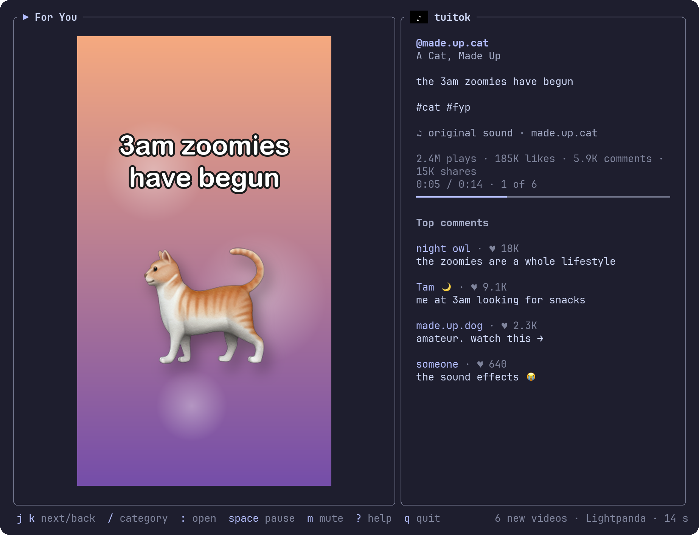

<div align="center">

# tuitok

**TikTok's For You, at the speed of your keyboard.**

A terminal TikTok client (TUI): one upright video at a time, `j` / `k` to scroll, its top comments beside it.<br>
Made for [Pepper](https://github.com/erictran308/pepper), the terminal that plays video inside a tab. No account, no login, and every start brings new videos.

[](LICENSE)
[](https://www.rust-lang.org)
[](https://github.com/erictran308/pepper)
[](https://github.com/lightpanda-io/browser)

**[Get started](#get-started)** · **[Pepper](#made-for-pepper)** · **[Keys](#keys)** · **[How it works](#how-it-works)** · **[Privacy](#privacy-and-security)**



<sub>The demo's made-up video and comments: <code>tuitok --demo</code></sub>

</div>

> [!IMPORTANT]
> **For personal use only.** tuitok isn't made, endorsed or allowed by TikTok or ByteDance. It reads TikTok's web feed through a headless browser, which TikTok's terms don't permit. It never logs in. See the [disclaimer](#disclaimer).

---

## Why tuitok

- **For You, one at a time.** The video upright in its own box, its cover while it loads, and beside it the author, caption, sound, plays, likes, comments and shares, where it's at with a bar of how far, and its top comments. Each video loops, as on TikTok.
- **Or a category.** `/` opens a command line at the bottom, as tuitube's `:` does: type to narrow For You and Explore's 21 categories (Comedy, Food, Animals, Sports…), `enter`, and that's what plays. A category needs no browser: its first videos come in a second or two. (TikTok's keyword search needs an account, so tuitok has none.)
- **Or a link.** Paste a TikTok video's link, type `:open` and the link, or start `tuitok LINK`, and that video plays next, in about a second, with no browser: `k` goes back to where you were, `j` on with the feed. Short links (`vt.tiktok.com/…`) work too.
- **Inside the terminal, in Pepper.** In a [Pepper](#made-for-pepper) tab the video plays in its box, in the same tab as your shell, straight from the graphics chip; `f` fills the tab with it. In any other terminal it plays in mpv's window, with its cover in the box.
- **Plays in about 2.5 seconds.** The first batch is a single video, then they grow 2, 3, 5, 8 and 13, one after another, each video handed on as soon as TikTok's page has it. The next three are downloaded while you watch, so `j` plays the next one straight away.
- **Top comments, as TikTok ranks them.** Up to ten, as many as fit, with their likes, under the counts: fetched for the video you're on and the next, from TikTok's comment list, with no cookie.
- **A fraction of a browser.** A small headless browser ([Lightpanda](https://github.com/lightpanda-io/browser), else Chrome) opens TikTok's For You only to fetch a batch, about 10 s for 13 videos, then closes. After the first 32 videos, the next 13 are fetched only when you reach the 8th of the last 13. [The numbers](#why-a-terminal).
- **Keyboard only.** Arrows or vim keys, nothing to click.
- **New videos every time.** tuitok goes on as the same TikTok guest from one run to the next and skips what you've watched, so a new start doesn't replay the same popular videos. `tuitok --forget` starts over.

## Made for Pepper

[Pepper](https://github.com/erictran308/pepper) is [Ghostty](https://ghostty.org), the terminal, with one thing added: a program can play a video in a box of cells inside a tab. The picture goes from the graphics chip to the screen with no copies, and everything else is Ghostty, unchanged: your config, your fonts, your keys.

tuitok is built around it:

- **The video plays in the tab.** It sits in its upright box beside the panel, in the same window as your shell and your editor: no window to move, or to lose behind the others.
- **`f` fills the tab** with the video, and `f` again brings the panel back. Pepper's ⌘↩ makes the window full screen too.
- **Pepper's own player.** tuitok drives `pepper-play`, which comes inside Pepper.app and plays through Homebrew's mpv, decoded on the graphics chip: TikTok's H.265 up to 1080×1920.
- **Light on your Mac.** Pepper's player, Pepper and tuitok together use about 18% of a core while a video plays, against 49% for TikTok in a Chrome window ([measured](#why-a-terminal)).

To get Pepper, download `Pepper.zip` from [its releases](https://github.com/erictran308/pepper/releases), drag Pepper.app to Applications and open it (Apple silicon Macs; [its README](https://github.com/erictran308/pepper#install) has the steps). Then run tuitok in a Pepper tab: `tuitok --check` says whether it found Pepper and its player.

Run it in a plain Pepper tab, not inside tmux, GNU screen, zellij or herdr. A multiplexer in between keeps Pepper from knowing where the box is, so there the video plays in mpv's window, and the panel says so.

## Why a terminal

TikTok in a browser is heavy. Measured on an Apple M5 Pro the way Pepper's own bench measures: the share of one CPU core, and memory as Activity Monitor shows it.

| What runs | CPU | Memory |
| --- | --- | --- |
| **TikTok's For You in a Chrome window** | **49%** | **1.5 GB** (2.3 GB at its peak) |
| Pepper's player, a TikTok video in tuitok's box | 10% | 220 MB |
| Pepper, drawing the tab while it plays | 5% | the terminal you have open anyway |
| A ratatui app like tuitok, on screen | 2.5% | 40 MB |
| **tuitok in Pepper, all of it** | **about 18%** | **about 260 MB** |

The browser that fetches the feed runs only while it fetches: Lightpanda takes 1.6 s and 0.7 s of CPU for the first video, and about 10 s, 2.4 s of CPU and under 300 MB for a batch of 13, then closes.

## Get started

**1. Install what tuitok runs.** It finds them on your `PATH`, in Homebrew's folders and in `/Applications`:

| Program | What for |
| --- | --- |
| [Pepper](https://github.com/erictran308/pepper) | The terminal to run it in, so the video plays inside the tab (any terminal works, with mpv's window) |
| [mpv](https://mpv.io) | Plays the videos: Pepper's player uses it, and other terminals get its window |
| [Lightpanda](https://github.com/lightpanda-io/browser) | The small headless browser that fetches the feed ([Chrome](https://www.google.com/chrome/) works too, heavier) |

```sh
brew install mpv lightpanda-io/browser/lightpanda
```

**2. Install tuitok** (Rust 1.90 or newer):

```sh
cargo install --git https://github.com/erictran308/tuitok --locked
```

**3. Run it** in a Pepper tab:

```sh
tuitok --check    # what it found: Pepper, its player, a browser, mpv
tuitok
```

`tuitok https://www.tiktok.com/@…/video/…` plays that video first, then For You. `tuitok --demo` shows the screen with made-up videos, fetching and playing nothing. `tuitok --feed` fetches one batch and lists it. `tuitok --forget` forgets the last run's guest and what you watched. tuitok runs on macOS, and on Linux without Pepper (in mpv's window).

## Keys

| Key | |
| --- | --- |
| `j` or `↓` | the next video |
| `k` or `↑` | the one before |
| `/` | For You, or one of Explore's 21 categories: type to narrow, `↑` `↓`, `enter` |
| `:` | a command: `open <link>` plays a TikTok link (`tab` completes `open`); pasting a link does the same |
| `space` | pause |
| `m` | mute |
| `-` `+` | volume down or up (kept for next time) |
| `h` `l`, `←` `→` or `,` `.` | back or on 5 s |
| `f` | the video fills the tab (Pepper), or mpv's window the screen |
| `?` | every key, and the settings: `tab` to them, then pick a theme with `j` `k` and `enter` |
| `r` | fetch more now |
| `q` | quit |

## How it works

1. **The feed.** TikTok's feed answers only requests its own page signs, so a headless browser opens `tiktok.com/foryou` as a logged-out guest and tuitok reads the videos the page asks TikTok for. Pictures, fonts, video and sound are refused, so the page fetches little else. The guest's cookies go from one batch to the next, and from one run to the next, so TikTok carries on with the same guest instead of starting over with the same popular videos; what you watched is skipped if TikTok sends it again.
2. **Batches that grow.** 1, 2, 3, 5, 8 and 13 videos, one after another, so the first plays as soon as the page has it; then 13 at a time, once you reach the 8th of the last 13.
3. **Downloads ahead.** The video you're on and the next three, in H.265 where TikTok has it (sharper and smaller than its H.264), sized for the box. Long videos stream instead.
4. **Playing.** In Pepper, through `pepper-play` into the box; elsewhere, in mpv's window. One player for the whole run, driven over a private socket.
5. **Covers and comments.** Fetched straight from TikTok for the video you're on and the next ones, and kept in memory.
6. **Categories.** Explore's videos answer a plain request, so a category needs no browser: one visit to TikTok's Explore page makes a guest, then each page of about 15 videos takes under a second, the next fetched as you near the end.
7. **Links.** A video's page answers a plain request too: tuitok reads the video from it, with the guest cookie the page sets, kept in memory only. A short link is one redirect, read but not followed.

## Privacy and security

- **No account.** tuitok never logs in. The feed is TikTok's logged-out For You: popular videos for your country, not yours.
- **Little kept.** One small file, readable only by you, carries the guest from one run to the next: TikTok's guest cookies and the ids of the videos you watched (the newest 5,000), nothing else. `tuitok --forget` deletes it. Your theme and volume are kept in another, `settings.toml`. Videos are downloaded into a folder of that run's only, readable only by you, and it's deleted when tuitok quits (or by the next run, if it crashed); covers and comments stay in memory.
- **The browser runs only while it fetches**, with a profile of that run's, pictures, video and sound refused, and Lightpanda's telemetry off.
- **Only TikTok's own hosts** are fetched from, over https; redirects elsewhere are refused. Top comments come from TikTok's comment list, asked without any cookie; a category's videos with the guest cookie TikTok's Explore page gave, kept in memory only. What you type in the bar only narrows its list: it's never sent anywhere. A link opens only if it's TikTok's: tuitok keeps the video's id and fetches its page from that, never the link itself. Text from TikTok is cleaned before it's shown, pictures are decoded only as JPEG within size limits, and downloaded videos must be MP4s.
- **Nothing private on a command line.** The guest's cookies go only to the next batch's browser and to that file, and the one the videos need goes to the player only over its private socket. Read back, the file is checked as if TikTok had just sent it.

## Disclaimer

tuitok is an unofficial, independent hobby project. It is **not** affiliated with, endorsed by, sponsored by, or connected to TikTok or ByteDance. Reading TikTok this way breaks TikTok's terms of service. **You use tuitok entirely at your own risk**; it is provided "as is", and its authors are **not liable** for anything that comes of using it. For personal use only: do not use tuitok to download or redistribute videos, for automation, scraping, or any commercial purpose.

## License

MIT
